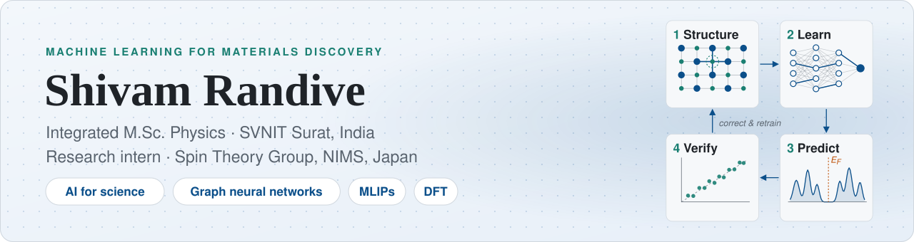
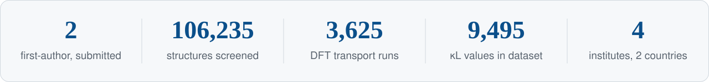
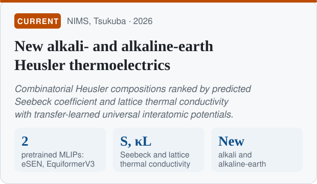
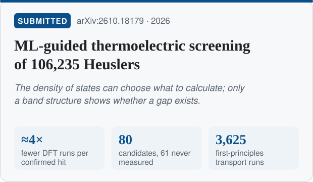
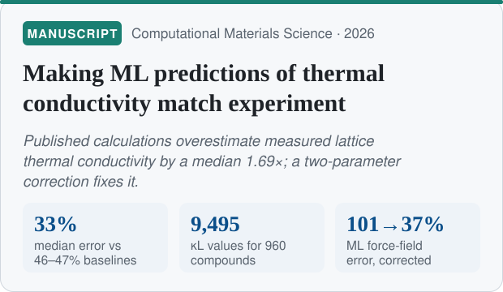
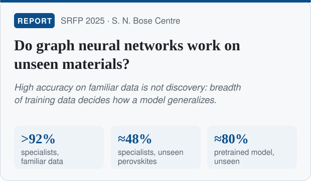
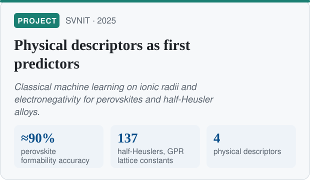
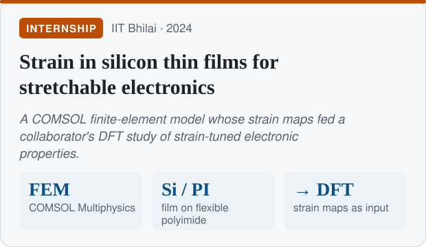
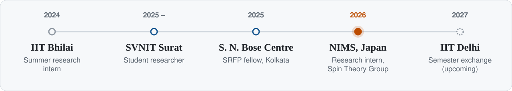

<picture>
  <source media="(prefers-color-scheme: dark)" srcset="assets/banner-dark.svg">
  
</picture>

  
  
  
  
  

I discover new alloys in the Heusler family and predict their properties for thermoelectric applications,
and I test every machine-learning prediction against first-principles calculations and experiment. Two
first-author papers submitted so far, and now transfer learning of universal interatomic potentials at NIMS, Japan.

<picture>
  <source media="(prefers-color-scheme: dark)" srcset="assets/stats-dark.svg">
  
</picture>

## Projects

  <a href="https://shivamrandive747.github.io/#research"><picture>
    <source media="(prefers-color-scheme: dark)" srcset="assets/card-nims-dark.svg">
    
  </picture></a>
  <a href="https://doi.org/10.48550/arXiv.2610.18179"><picture>
    <source media="(prefers-color-scheme: dark)" srcset="assets/card-screening-dark.svg">
    
  </picture></a>

  <a href="https://github.com/Shivamrandive747/half-heusler-kappa-calibration"><picture>
    <source media="(prefers-color-scheme: dark)" srcset="assets/card-kappa-dark.svg">
    
  </picture></a>
  <a href="https://drive.google.com/file/d/1dD-fT1N9dyx78ICVK90nR-8M5JnDo-rm/view?usp=sharing"><picture>
    <source media="(prefers-color-scheme: dark)" srcset="assets/card-srfp-dark.svg">
    
  </picture></a>

  <a href="https://drive.google.com/file/d/1rd77ryVKYCl4dzaDe2QpezefqtLPjPC3/view?usp=sharing"><picture>
    <source media="(prefers-color-scheme: dark)" srcset="assets/card-descriptors-dark.svg">
    
  </picture></a>
  <a href="https://drive.google.com/file/d/1M_lOCsnlSuaVTfAMZrHsLm-JbuOtV_dY/view?usp=sharing"><picture>
    <source media="(prefers-color-scheme: dark)" srcset="assets/card-strain-dark.svg">
    
  </picture></a>

Click a card to open the paper, code or report. Full descriptions are below.

<b>New alkali- and alkaline-earth Heusler thermoelectrics</b> · NIMS, Tsukuba · Spin Theory Group, Prof. Terumasa Tadano · 2026

 

- **Idea:** build new alkali- and alkaline-earth-metal Heusler compositions combinatorially and rank them by
  predicted Seebeck coefficient and lattice thermal conductivity, using universal machine-learned interatomic
  potentials (eSEN, EquiformerV3) that already learned chemistry from millions of DFT calculations.
- **Approach:** keep the pretrained network frozen and train a small model on its inner features, finding
  which layers, and which design (convolution or attention), best capture transport.
- **Status:** work in progress.

<b>ML-guided thermoelectric screening of 106,235 Heusler structures</b> · submitted · preprint <a href="https://doi.org/10.48550/arXiv.2610.18179">arXiv:2610.18179</a>

 

- **Problem:** transport calculations are too expensive for whole databases, so candidates are shortlisted from
  the cheaper density of states (DOS), often predicted by ML. This shortcut had never been tested at scale.
- **What I did:** trained 30 ALIGNN graph neural networks to predict the DOS of 54,978 structures (held-out
  *r* = 0.90 vs. 0.49–0.61 for simple baselines), and judged the shortlist with 3,625 first-principles transport
  calculations from my own Quantum ESPRESSO + BoltzTraP2 workflow.
- **Result:** a DOS-based Seebeck indicator finds the good compounds with about **4× fewer expensive
  calculations**, giving **80 candidate thermoelectrics** (61 never measured); 10 of 11 known half-Heusler
  thermoelectrics pass the same checks.
- **Message:** ML spectra miss most band gaps (recall 0.15) even when standard scores look good, so they can
  rank candidates but only a band-structure calculation can confirm a gap.
- **Code:** [heusler-dos-te-screening](https://github.com/yednaph/heusler-dos-te-screening)

<b>Making ML predictions of thermal conductivity match experiment</b> · submitted to a journal

 

- **Problem:** ML models of lattice thermal conductivity (κL) learn from calculated values, which
  overestimate experiment by a median **1.69×** (29 of 34 half-Heuslers).
- **What I did:** built a source-tracked dataset of 9,495 κL values for 960 compounds from five databases
  and the literature (1,178 values read by multimodal LLMs, each physics-checked), and a simple two-parameter
  correction from calculation to experiment.
- **Result:** predictions of measured κL reach **33% median error vs. 46–47% for baselines** (cubic
  18-electron compounds), close to the disagreement between two labs; the correction also cuts an independent ML
  force field's error from 101% to 37%. Released 10 testable predictions with 90% prediction intervals.
- **Code and data:** [half-heusler-kappa-calibration](https://github.com/Shivamrandive747/half-heusler-kappa-calibration)
  · [Zenodo](https://doi.org/10.5281/zenodo.23333947)

<b>Do graph neural networks work on unseen materials?</b> · SRFP 2025, S. N. Bose National Centre, Kolkata

 

- Built a full ALIGNN pipeline (crystal file → graph → prediction) and compared one broadly pretrained model with
  "specialist" models trained only on narrow perovskite families.
- **Result:** the specialists scored over 92% on familiar data but dropped to about 48% on new double
  perovskites, while the pretrained model kept about 80%.
- **Message:** breadth of training data matters more for discovery than high accuracy on a narrow test set.
- Supervised by Prof. Tanusri Saha-Dasgupta · [report](https://drive.google.com/file/d/1dD-fT1N9dyx78ICVK90nR-8M5JnDo-rm/view?usp=sharing)

<b>Physical descriptors as first predictors</b> · semester project, SVNIT, 2025

 

- Support-vector classifier for perovskite formability from ionic radii and the tolerance factor (≈90% accuracy).
- Reproduced a Gaussian-process model of lattice constants for 137 half-Heusler compounds from four descriptors.
- [Report](https://drive.google.com/file/d/1rd77ryVKYCl4dzaDe2QpezefqtLPjPC3/view?usp=sharing) ·
  earlier literature survey: [Mini-project-1-](https://github.com/Shivamrandive747/Mini-project-1-)

<b>Strain in silicon thin films for stretchable electronics</b> · internship, IIT Bhilai, 2024

 

- COMSOL finite-element model of a silicon film on a flexible polyimide substrate in a pressure cell; the strain
  maps were used by a collaborator as input for DFT calculations of how strain changes the film's electronic
  properties.
- [Report](https://drive.google.com/file/d/1M_lOCsnlSuaVTfAMZrHsLm-JbuOtV_dY/view?usp=sharing)

## Journey

<picture>
  <source media="(prefers-color-scheme: dark)" srcset="assets/journey-dark.svg">
  
</picture>

## Toolbox

  
  
  
  
  
  
  
  
   
  
  
  
  
  
  
  

---

  <b>Open to PhD positions in machine learning for materials.</b> 
  <a href="mailto:i22ph019@phy.svnit.ac.in">Email</a> ·
  <a href="https://shivamrandive747.github.io">Website</a> ·
  <a href="https://shivamrandive747.github.io/assets/Shivam_Randive_CV.pdf">CV</a> ·
  <a href="https://shivamrandive747.github.io/statement.html">Research statement</a> ·
  <a href="https://orcid.org/0009-0005-1403-4484">ORCID</a> ·
  <a href="https://scholar.google.com/citations?user=g3rGf_MAAAAJ">Google Scholar</a>

